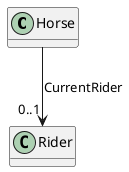

# OOB.05 -- E-Scooter Sharing: Modelling

## Teaching Topics

- Modelling: from a customer's story to a class diagram
- Finding classes, attributes and enums (nouns) and methods (verbs)
- Choosing the right kind of property: stored or computed, who may change it, checked or not
- Constants and `static` data
- Constructors, optional values and `: this(...)`
- Relationships between classes in UML
- UML class diagrams with PlantUML

## The Task

In `Pupils`, `HorseRace` and `Garage` you got a finished class diagram. Real projects don't work like that. A customer describes their problem in their own words, and **you** decide which classes the program needs, what data they hold and what they can do. That is called **modelling**, and it is what this exercise trains.

Read the story below, find the classes with their data and behavior, and draw your own class diagram in `model.puml`. You don't write any C# code in this exercise.

In the next exercise, **OOB.06 E-Scooter Sharing: Implementation**, you get a reference model for the same story, compare it with yours and implement it.

## The Story

> **ZoomLinz** is a young start-up that rents out e-scooters in Linz. They need the core of their system: the part that knows about customers, scooters and rides. The app with its buttons and maps will be built by somebody else later.
>
> Customers register in the ZoomLinz app with their name. Leading and trailing spaces are removed from the name, because people often type them by accident. Customers may change their name later (e.g. after a marriage). They can also enter an e-mail address. It is only accepted if it contains an `@`. Otherwise the old address is kept.
>
> Every customer has a tier: *Standard*, *Student* or *Premium*. New customers are Standard customers unless they choose a different tier when they register. They can switch to another tier at any time, e.g. when they buy a Premium subscription.
>
> Riding costs money, so every customer has a prepaid balance, which starts at 0 €. Customers top up their balance with any amount from 5 € up to 100 €. After each ride, its price is deducted from the balance. The balance may become negative after a ride (nobody wants to be stopped in the middle of the Nibelungenbrücke), but a customer can only start a ride if they have at least 2 € on their account.
>
> ZoomLinz owns a fleet of scooters. Each scooter has a model name (e.g. "Xiaomi 4 Pro") and a unique fleet number that is assigned automatically: the first scooter gets number 1001, the next one 1002, and so on. Every scooter has a battery with a charge level between 0 and 100 percent, and it can never be below 0 or above 100. New scooters come fully charged from the factory, but ZoomLinz also buys used scooters from other companies, which arrive with any battery level. Riding one kilometer uses 2 percent of the battery (rounded up to whole percent after each ride). So the app can show how many kilometers a scooter can still go, its *range*. The service team recharges scooters by a given number of percent, but never while somebody is riding them.
>
> A customer can start a ride on a scooter if the scooter is available and the customer has enough money. A scooter is available if nobody is riding it and its battery is at least 15 percent. A customer may ride several scooters at the same time (e.g. they rent one for a friend). When the ride ends, the app reports how many minutes it took (at least 1) and how many kilometers were driven. Then the ride's price is calculated, the customer pays it, the scooter's battery goes down and the scooter is free again. A ride can't be ended twice.
>
> The price depends on the customer's tier when the ride ends:
>
> | Tier     | Unlock fee | Per minute |
> | -------- | ---------- | ---------- |
> | Standard | 1.00 €     | 0.25 €     |
> | Student  | 1.00 €     | 0.15 €     |
> | Premium  | 0.00 €     | 0.20 €     |
>
> For every ride, the fleet manager wants to know who rode which scooter, for how long, how far, and what it cost.

## Step 1: Find the Candidates

Mark every **noun** in the story. For each one, decide what it is:

| It is …          | If …                                                                                         | Examples from `Pupils` / `HorseRace` |
| ---------------- | -------------------------------------------------------------------------------------------- | ------------------------------------ |
| a **class**      | there are several distinct things of this kind, and each one has its own data *and* behavior | `Pupil`, `Horse`                     |
| an **attribute** | it is just a value (a number, a text, a yes/no, a date) that describes something else        | first name, age, start number        |
| an **enum**      | it is a value from a small, fixed list of possibilities                                      | `AgeType`                            |
| **irrelevant**   | it is outside of the system, or it is the system itself                                      | the school, the teacher, the program |

> [!TIP]
> **Some nouns are tricky**
>
> - "The fleet" would be an array of scooters, like the horses in `HorseRace`. The system doesn't need it yet, so ignore the fleet for now.
> - An **event** can be a class too, if it has data of its own that must be remembered afterwards.
> - Ask yourself: "Would I need to *create* several of them with `new`?" If the answer is no, it is probably not a class.

## Step 2: The Data of Each Class

For each class, list its attributes with a name and a C# data type. Then answer three questions for every attribute:

1. **Stored or computed?** Can the value be calculated from other data at any time? Then don't store it.
2. **Who may change it?** Nobody after the object is created, only the object itself (through its methods), or anybody from outside?
3. **Must a new value be checked or cleaned up?** If so, what happens with an invalid value: is it *ignored*, or is it *corrected* to the nearest valid value?

The answers tell you which kind of property to write:

| You need …                                                       | Use                              | In the diagram           |
| ---------------------------------------------------------------- | -------------------------------- | ------------------------ |
| a value that can be read and changed from anywhere               | auto property `{ get; set; }`    | no suffix                |
| a value others may read, but only the class may change           | `{ get; private set; }`          | `[private set]`          |
| a value that never changes after the constructor                 | get-only property `{ get; }`     | `[readonly]`             |
| to check, clean up or react to a new value                       | `set` with a body, using `field` | as above                 |
| the same, when the backing field must be visible in the diagram  | explicit backing field           | `-int _field` listed too |
| a value that follows from other data                             | computed property `=> ...;`      | `[readonly]`             |

Also look for fixed numbers in the story (limits, prices, percentages). They become constants (`[const]`), so that no "magic numbers" appear in your code. And think about data that belongs to the class as a whole rather than to one object. That data is `static`.

## Step 3: The Behavior of Each Class

Now mark the **verbs** in the story: *top up*, *pay*, *recharge*, *start a ride*, *end a ride*, … They are candidates for methods. For each one, decide:

- **Which class is responsible?** Rule of thumb: the class whose data changes does the work. If a scooter's battery goes up, the scooter recharges itself.
- **Which parameters does it need**, and what does it return?
- **Can it fail?** An operation that is not always possible returns a `bool`. If it also creates a new object, use the `TryParse` pattern you already know: `bool TryX(..., out T? result)`.

Yes/no questions about an object ("Can this customer rent?") are usually computed `bool` properties, not methods.

## Step 4: Constructors

For each class, decide what data an object needs **from its very first moment**. Everything that is required goes into the constructor. If some values are optional or have a sensible default, add a second constructor that calls the first one with `: this(...)`.

## Step 5: Relationships

Which objects need to know other objects? If an object of class A has to reach an object of class B later, A gets a property of type B. In PlantUML, draw this as an arrow from A to B, with the property name and how many B objects there are:

`0..1` means "none or one", so the property is nullable (`Rider?`). `1` means "exactly one", so the property is never `null`.

## Step 6: Draw Your Class Diagram

Write your model into `model.puml`, which is next to this readme. Use the notation you know from the class diagrams so far:

- `+` for `public`, `-` for `private`
- `{static}` in front of static members
- the suffixes `[const]`, `[readonly]` and `[private set]` behind a member
- constructors as `+ClassName(parameter types)`, methods as `+ReturnType Name(parameter types)`

Render it (e.g. with the PlantUML plugin of your IDE) and check it against the story once more.

> [!TIP]
> **Check yourself**
>
> - Can you point to the sentence in the story that each member comes from?
> - Is there a rule in the story that none of your members takes care of?
> - Which properties did you mark as computed? Why is the price of a ride *not* computed from the current tier?
> - Which constructor parameters are optional?
> - Which of your methods return `bool`, and when do they return `false`?

## Requirements

1. Your result is `model.puml` with all classes, enums, members and relationships you need for the story.
2. Every member has a C# data type and a visibility. Properties carry the right suffix.
3. Be ready to explain for each member which sentence of the story it comes from.
4. Discuss your diagram with a classmate or your teacher. Only then do you get the reference model for the implementation part.
